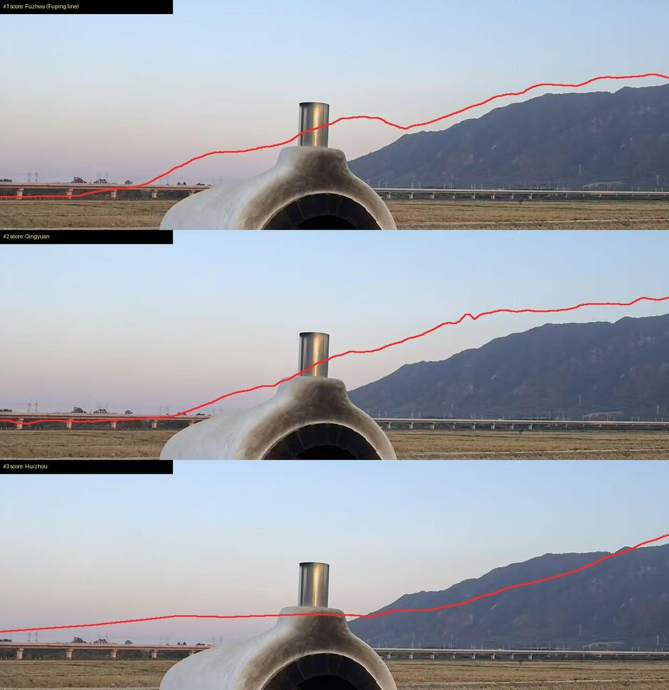
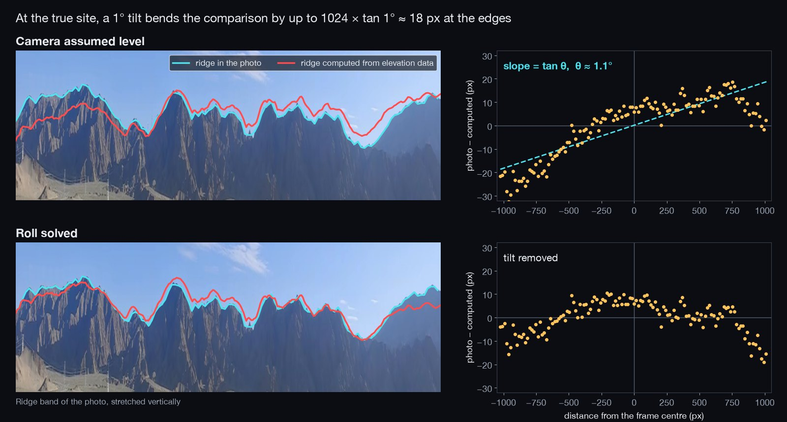

# Geo Sleuth Skill for Evidence Based Photo Geolocation

Geo Sleuth Skill helps an agent investigate where a photograph was taken.
Geo Sleuth combines visual clues with geographic data and records the evidence behind its conclusions.
This Geo Sleuth Skill guide focuses on photo geolocation and the distinction between a candidate and a verified match.

Geo Sleuth Skill features include image intake, map-based investigation, candidate ranking, and evidence reporting.
A useful Geo Sleuth Skill tutorial follows one image from observation to a supported location estimate.

This repository pairs that overview with selected PIGEON research files as technical references.
The linked files below belong to PIGEON and do not constitute a Geo Sleuth installation.

[](https://geo-sleuth-skill.github.io/Geo-Sleuth/)

## Why geo-sleuth

A photograph can contain useful geographic information even when it has no GPS metadata.
Road geometry, terrain, text, and visible infrastructure can each narrow the search.

The strongest investigation combines clues that test different aspects of a candidate.
A familiar-looking building alone is weaker than a match supported by independent observations.

- Separate visible observations from interpretations.
- Keep several plausible locations until evidence distinguishes them.
- Compare geometry rather than relying only on resemblance.
- Record the source and output behind a claim.
- Report uncertainty at the location level the evidence supports.

| Evidence | Useful question | Limitation to inspect |
| --- | --- | --- |
| Image metadata | Does the file contain a location or capture time? | Missing or edited metadata |
| Readable text | Which places fit the language or wording? | Recognition errors and ambiguous names |
| Street geometry | Do intersections and building arrangements agree? | Incomplete or outdated map coverage |
| Terrain skyline | Does the visible ridge match the viewpoint? | Camera tilt and limited elevation resolution |
| Satellite imagery | Are the expected features present? | Image date, scale, and visibility |
| Street-level imagery | Do several distinctive ground-level details match? | Coverage gaps and scene changes |

The table is a guide to questions, not a guarantee of a precise answer.
Some images support only a broad region.



## Description

Geo Sleuth is an agent skill maintained in the Oldcircle project.
Its documented task is finding a photo's location with evidence that can be inspected.
This overview does not describe a geocaching cipher decoder.

The research references illustrate a different approach to image geolocation.
PIGEON studies model-based prediction, while Geo Sleuth organizes an investigation around tools and evidence.

In the supplied research selection, [config.py](config.py) defines model and data paths.
The environment specification is [env.yml](env.yml).
The research entry point is [run.py](run.py).

Those settings and commands belong to PIGEON.
They do not configure or launch the Geo Sleuth skill.

## How it works

A practical investigation moves from observation to candidate generation, comparison, and reporting.
Each stage should preserve what was learned and what remains uncertain.

1. Inspect the original image and useful crops.
2. Record text, structures, terrain, and other visible clues.
3. Generate candidates using relevant geographic sources.
4. Compare the strongest candidates against independent constraints.
5. Preserve the evidence for accepted and rejected locations.
6. State the supported location, uncertainty, and remaining alternatives.

Geo Sleuth's candidate board helps keep clues and competing hypotheses organized.
The final report should distinguish a computed result from a visual interpretation.

For related research preprocessing, see [dataset_preprocessing.py](preprocessing/dataset_preprocessing.py).
The embedding workflow is [embed.py](preprocessing/embed.py).
The auxiliary geographic enrichment implementation is [geo_augmentor.py](preprocessing/geo_augmentor.py).

These files help explain the preparation required by a model-based pipeline.
They are separate from Geo Sleuth's photo-intake scripts.

## Toolbox

Geo Sleuth's upstream toolkit includes image intake, geographic queries, terrain analysis, and comparison tools.
Choose a tool because it can test a specific clue.
A successful command is useful only when its output addresses the question being investigated.

In a complete upstream Geo Sleuth checkout, the following Bash example checks the environment and prepares an image:

```bash
uv run skills/geo-sleuth/scripts/doctor.py --json
case_image="landscape.jpg"
case_output="landscape-intake"
uv run skills/geo-sleuth/scripts/intake.py "$case_image" --out-dir "$case_output" --no-rev
```

The example requires an existing image at the chosen path.
The intake command disables reverse image search for that step.
Dependency downloads or local processing requirements can still apply.

The supplied PIGEON selection does not contain those Geo Sleuth scripts.
Use the complete upstream skill when following its command-line workflow.

For the research representation of geographic areas, inspect [cell.py](dataset_creation/geocell/cell.py).
The related collection abstraction is [cell_collection.py](dataset_creation/geocell/cell_collection.py).
These research cells should not be confused with Geo Sleuth's candidate board.

## Method

Location estimates become more useful when their geographic meaning is explicit.
Keep coordinate order, units, and the distinction between prediction and ground truth visible.

The supplied research helper [geo_utils.py](preprocessing/geo_utils.py) implements geographic calculations.
Its functions support distance and coordinate operations in the PIGEON pipeline.

This independent Python example measures the separation of two illustrative coordinate pairs:

```python
from math import asin, cos, radians, sin, sqrt

a, b = (48.850, 2.350), (48.860, 2.360)
lat1, lon1, lat2, lon2 = map(radians, (*a, *b))
h = sin((lat2 - lat1) / 2) ** 2 + cos(lat1) * cos(lat2) * sin((lon2 - lon1) / 2) ** 2
distance_km = 2 * 6371.0088 * asin(sqrt(min(1.0, h)))
print(f"Separation: {distance_km:.3f} km")
```

The coordinates are examples, not a claim about any photograph.
The calculation uses a spherical approximation and is not an uncertainty estimate.

PIGEON's image representation is implemented in [clip_embedder.py](models/clip_embedder.py).
Its prediction model is [super_guessr.py](models/super_guessr.py).
Prototype-based refinement is implemented in [proto_refiner.py](models/proto_refiner.py).

A model-ranked location remains a hypothesis until the investigation checks it against the scene.



## What's inside

Geo Sleuth separates investigative instructions, helper scripts, reference material, and supporting data.
Its upstream documentation explains how those resources work together.

The included PIGEON reference contains model layers useful for studying a research architecture:

- [positional_encoder.py](models/layers/positional_encoder.py) adds positional information to model inputs.
- [hedge.py](models/layers/hedge.py) implements a probability-adjustment strategy for competing geographic guesses.

These modules are research components rather than additional Geo Sleuth features.
The PIGEON release does not supply the model weights and datasets needed to reproduce every workflow.

## Benchmarks

Evaluate an investigation at the precision level it actually supports.
Country, city, road, and camera-position claims require different evidence.

- Record what information was available at the start.
- Keep the original image separate from annotated evidence.
- State whether an example influenced the method being tested.
- Distinguish unseen-photo evaluation from a regression check.
- Compare predicted coordinates with independently known coordinates.
- Record failed routes and unresolved alternatives.

The supplied research metrics are implemented in [metrics.py](evaluation/metrics.py).
The evaluation orchestration is [evaluate.py](evaluation/evaluate.py).
Neither file establishes an accuracy guarantee for Geo Sleuth.

An impressive result on one photograph does not establish the same precision on another.
Report the actual evidence and search coverage for each case.

## Contributing

A useful report identifies the first stage where an investigation went wrong.
Include enough context to distinguish a data problem, a tool failure, and a reasoning error.

For Geo Sleuth changes, follow its upstream contribution guidance.
For the included PIGEON files, use the research project's own documentation and citation requirements.

- Describe the input and any hints provided.
- Identify the command and parameters involved.
- Preserve relevant output and error messages.
- Explain the expected behavior.
- Test a general improvement against more than the motivating image.

## Acknowledgements

Geographic investigations depend on map contributors, imagery providers, elevation datasets, and model authors.
Preserve the applicable attribution when sharing evidence or derived material.

Credit Geo Sleuth and PIGEON separately when discussing their respective methods.
A shared subject does not make their code, dependencies, or results interchangeable.

## Related Search Terms

Geo Sleuth Skill, Geo Sleuth, Geo Sleuth Skill guide, Geo Sleuth Skill features, Geo Sleuth Skill tutorial, agent-skills, ai-agents, computer-vision, geolocation, image-geolocation, photo-geolocation, openstreetmap, osint, geoint, satellite-imagery
